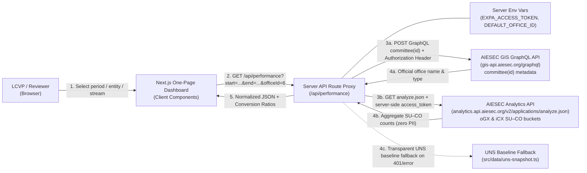

# AIESEC in UNS — One-Page Performance Dashboard

**Applicant:** Nurman Aqil Wicaksono  
**Role:** Staff Web Developer — Indonesia In-house Development (IID) 26.27  
**Default Entity:** AIESEC in UNS (`Office ID: 6`, Parent MC Indonesia `1539`)  

A one-page oGX & iCX performance analytics dashboard prototype built with **Next.js (App Router), TypeScript, Tailwind CSS, Recharts, GSAP, and Lenis**, integrating **AIESEC GIS GraphQL** (office metadata) and the **AIESEC Analytics API** (`SU`–`CO` funnel metrics).

---

## Key Features
- **oGX & iCX Funnel (SU – CO):** Displays Sign-Ups (`oGX` only, following AIESEC/CORE convention), Applicants (`applicants.value`), Accepted, Approved, Realized, Finished, and Completed (`doc_count`) with step-by-step conversion ratios.
- **6-Product Scorecard:** Interactive breakdown for `oGV`, `oGTa`, `oGTe`, `iGV`, `iGTa`, and `iGTe` with click-to-isolate chart filtering.
- **AIESEC-Native Time Period Filters & Smart Apply:** Quick presets (`MC Term`, `LC Term`, `This Quarter`, `This Month`, `Prev Month`) load immediately without activating the `Apply` button and cancel mid-flight if the user returns to the already-loaded period. Changes to `Start Date`, `End Date`, `Entity / LC Scope`, or `Custom Office ID` enable the `Apply` button (disabled when unchanged).
- **Interactive Motion & Loading Feedback:** Bottom-up Recharts bar-fill animation when switching products/filters (respects `prefers-reduced-motion`) and a blur-only loading overlay (`Updating performance data…`) on the chart container during API refreshes.
- **Flexible Entity / Token Support:** Defaults to **AIESEC in UNS (`#6`)** and supports switching to MC Indonesia (`#1539`) or any custom Office ID when backed by a token with appropriate EXPA permissions.
- **Tabbed Conversion Rates Matrix:** Select any base stage (`SU`–`FI`) to inspect downstream conversion percentages across `Total`, `oGX`, `iCX`, and all 6 products (`SU` base keeps `Total` scoped to `oGX` for consistency with KPI step ratios).
- **3-Way Report Export (Full Payload Scope):**
  1. **Executive PDF / Print Report** (browser print-to-PDF layout with print-safe motion teardown)
  2. **CSV Export** (UTF-8 BOM, Excel & Google Sheets ready, with explicit source & scope headers)
  3. **Copy Summary** (plain-text LC summary ready for WhatsApp/LINE groups)
- **Transparent Fallback Mode:** When `EXPA_ACCESS_TOKEN` is missing or expired (~2 hours), the server serves elapsed-day scaled baseline fallback data for **AIESEC in UNS (`#6`)** and **AIESEC in Indonesia (`#1539`)** (so `MC Term`, `LC Term`, and custom ranges reflect distinct elapsed durations) with a concise fallback notice banner.

---

## How It Connects to EXPA (Hybrid Architecture Diagram)



---

## How the EXPA API Key / Token Is Kept Secret
1. **Server-Side Proxy Only:** The browser only calls `/api/performance`. Neither `gis-api.aiesec.org` nor `analytics.api.aiesec.org` is called from client-side JavaScript.
2. **Private Environment Variables:** `EXPA_ACCESS_TOKEN` has **no** `NEXT_PUBLIC_` prefix, so Next.js never bundles or exposes it in client code or browser DevTools.
3. **No Token Logging:** Upstream Analytics URLs containing `access_token` are constructed and consumed strictly in memory on the server and are never logged or returned to the client.
4. **Git & Deployment Hygiene:** `.env.local` is ignored via `.gitignore`. Only `.env.example` is committed. On Vercel, `EXPA_ACCESS_TOKEN` is stored in **Project Settings → Environment Variables**.
5. **Known Operational Limits & Production Upgrade Path:**
   - The 60-second in-memory cache + in-flight deduplication reduces duplicate upstream calls per running instance, but is **not** a distributed cache or global rate limiter.
   - Temporary `aiesec_token` values expire after ~2 hours. A production IID deployment should register an approved **AIESEC Developer Application** (`auth.aiesec.org/developers/oauth_applications`) and implement server-side **OAuth 2.0 `refresh_token`** renewal plus intentional access/rate-limit policies on the public proxy.

---

## How to Run Locally

### Prerequisites
- Node.js 20+ and npm

### Steps
```bash
# 1. Install dependencies
npm install

# 2. Create local environment file
cp .env.example .env.local
```

Open `.env.local` and set your EXPA access token:
```env
EXPA_ACCESS_TOKEN=your_expa_token_here
EXPA_GRAPHQL_URL=https://gis-api.aiesec.org/graphql
DEFAULT_OFFICE_ID=6
```

```bash
# 3. Start development server
npm run dev
```
Open `http://localhost:3000`.

### Run Tests & Production Build
```bash
npm test
npm run build
npm start
```

---

## How a Future IID Team Can Update This Project
- **Change Default LC/MC:** Update `DEFAULT_OFFICE_ID` in `.env.local` / Vercel Environment Variables, or add more entities in `src/lib/entities.ts` (IDs come from AIESEC's `List of Office IDs`).
- **Switch API Endpoints / Staging:** Set `EXPA_GRAPHQL_URL` (e.g. `https://staging-jruby.aiesec.org/graphql`) or `EXPA_ANALYTICS_URL` in server env vars.
- **Adjust Data Mapping or GraphQL Queries:** Edit `src/lib/expa-graphql.ts` (office metadata query via GIS GraphQL + funnel bucket mapping from `analyze.json`).
- **Update Design Tokens & Layout:** All CSS tokens (`Lato`, `#FAF9FB`, `#BF0820`, programme accents, dark mode extension, 1600px workspace) live in `src/app/globals.css`; GSAP + Lenis lifecycle lives in `src/lib/use-dashboard-motion.ts`.
- **Extend Export Formats:** Edit `src/lib/export-report.ts`.

---

## Two Things That Went Wrong During Development & How I Handled Them
1. **GIS GraphQL `people` & `allOpportunityApplication` Returned `0` Under LC Back-Office RBAC (and Large Aliased Queries Timed Out):**  
   When testing live against `gis-api.aiesec.org/graphql` with my own EXPA token, `currentPerson` and `opportunities` worked, but `people` and `allOpportunityApplication` returned `total_items: 0` due to EXPA role-based access control on individual application records, and batching 39 aliased GraphQL queries triggered request timeouts.  
   **How I handled it:** I combined **AIESEC GIS GraphQL** (`committee(id)` for live official office metadata) with **AIESEC's official Analytics API** (`analytics.api.aiesec.org/v2/applications/analyze.json`, documented in Dev Guide 03) inside the server-side proxy, plus 60-second per-instance caching and in-flight request deduplication. This returns EXPA-canonical `SU`–`CO` funnel counts for `oGX` & `iCX` across all 6 products (`GV`, `GTa`, `GTe`) without exposing PII.
2. **Temporary EXPA Tokens Expire After ~2 Hours (Breaking Public Reviewer Demos):**  
   A `quick-and-dirty` `aiesec_token` from EXPA Local Storage expires after ~2 hours, which would cause a deployed public link to show `401 Unauthorized` when reviewers open it later.  
   **How I handled it:** I implemented a **transparent server-side fallback** in `/api/performance`: the route always attempts a live EXPA fetch first, and if EXPA returns `401`/`403` or no token is configured, it serves the UNS (`#6`) MC26 baseline fallback (without mislabelling it as another office) while displaying an explicit fallback notice banner.
